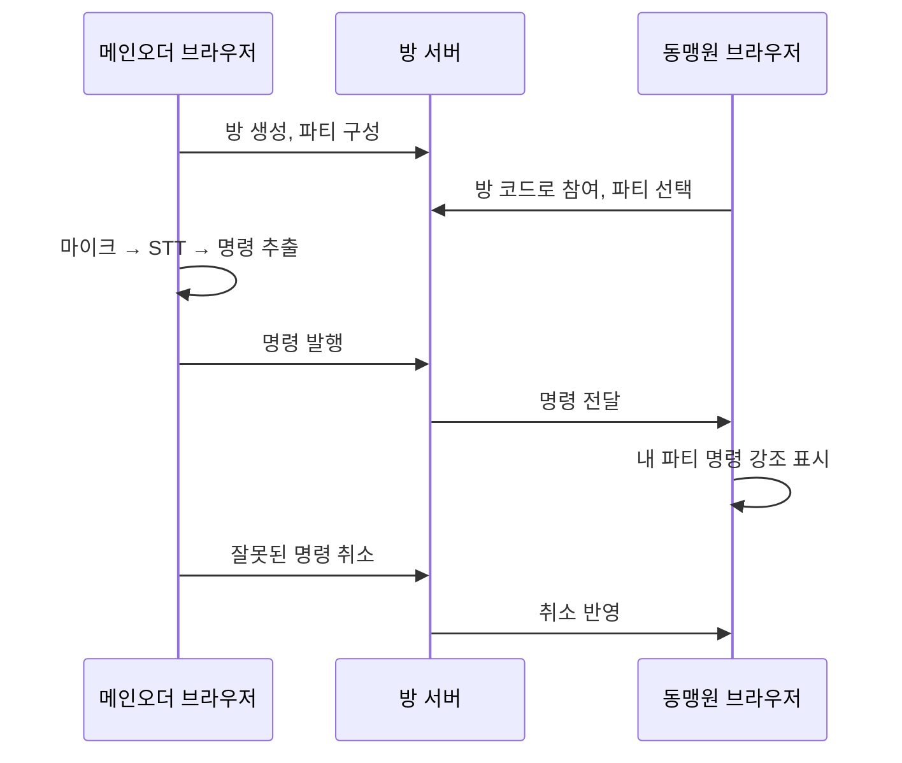

# PRD — Winds Command

작성일: 2026-11-26 · 상태: 초안 · 원본: [서비스 초기 기획서](../service-plan.md)

## 1. 요약

Winds Command는 연운(Where Winds Meet) 동맹전에서 메인오더가 말한 전술 명령을 자동으로 글과 그림으로 바꾸어 동맹원 화면에 보여 주는 웹 서비스다.
메인오더는 평소처럼 디스코드로 말하기만 하고, 동맹원은 자기 파티의 현재 명령을 화면에서 바로 확인한다.
첫 목표는 우리 동맹의 실제 동맹전에 정착하는 것이다.

## 2. 배경

- 동맹전에서는 메인오더 한 명이 음성으로 여러 파티에 명령을 내린다.
- 전투 중에는 교전 소리, 다른 사람의 말, 내 조작에 집중이 나뉘어 명령을 놓치기 쉽다. 기획자도 동맹원으로서 이 문제를 겪었다.
- 명령은 한 번 말하면 사라진다. 놓친 사람이 "지금 뭐 하래요?"라고 다시 물으면 음성 채널이 더 혼잡해진다.
- "1파티 2파티는 중앙, 3파티는 오른쪽"처럼 여러 파티에 대한 명령은 듣는 사람이 내 몫을 골라내야 한다.

**왜 지금 가능한가**

- 한국어 스트리밍 음성인식 모델(sherpa-onnx Zipformer)을 WebAssembly로 브라우저에서 돌릴 수 있다. 그래서 서버 연산 비용 없이 음성을 인식할 수 있다.
- Cloudflare Workers와 Durable Objects로 방 단위 실시간 중계를 무료 한도 안에서 운영할 수 있다. 무료 한도의 정확한 수치는 [06-tech-decisions.md](06-tech-decisions.md)에서 확인한다.

## 3. 목표와 핵심 결과

**목표**: 우리 동맹원이 동맹전 중 자기 파티의 명령을 놓치지 않게 하고, 메인오더의 지휘 방식은 바꾸지 않는다.

| KR | 내용 | 측정 방법 |
|---|---|---|
| KR1 | 우리 동맹 연속 4회 동맹전에서 메인오더가 시작부터 끝까지 서비스를 켜 두고 사용한다 **[제안]** | 세션 요약의 음성인식 가동 시간 / 동맹전 시간 |
| KR2 | 동맹전 참여 인원 중 50% 이상이 오더방에 접속한다 **[제안]** | 세션 요약의 최대 동시 접속 수 / 참여 인원 |
| KR3 | 세션당 잘못 발행된 명령(취소된 음성 명령)이 2% 이하이고, 사후 설문에서 70% 이상이 "명령 파악에 도움이 됐다"고 답한다 **[제안]** | 세션 요약의 취소 수 / 음성 발행 수, 디스코드 설문 |

> KR1이 가장 중요하다. 메인오더가 켜 두지 않으면 나머지 지표는 생기지 않는다.
>
> KR3의 2%는 PoC 목표(오발행 1% 미만)보다 느슨하다. 실전 취소에는 메인오더가 마음을 바꾼 경우도 섞이기 때문이다. 세션 요약에서 취소 사유("잘못 인식" / "작전 변경")를 구분할 수 있으면 오발행만 따로 센다.

## 4. 대상 사용자 (시장 세그먼트)

첫 버전은 아래 두 세그먼트에 집중한다. 둘 다 우리 동맹 안의 사람이다.

| 세그먼트 | 겪는 문제 | 조건·제약 |
|---|---|---|
| S1. 동맹원 | 전투 중 내 파티 명령을 놓치거나 다른 파티 명령과 헷갈린다 | 게임 중이라 화면을 오래 볼 수 없다. 휴대폰이나 보조 모니터로 볼 가능성이 높다 **[가정 A-3]** |
| S2. 메인오더 | 같은 명령을 반복하고, 전달됐는지 확인하기 어렵다 | 게임과 디스코드에 집중해야 하므로 추가 조작을 거의 할 수 없다. 아직 메인오더의 의견은 듣지 않았다 **[가정 A-1]** |

다른 동맹으로 넓히는 일은 우리 동맹에 정착한 뒤에 한다.

## 5. 가치 제안

### S1. 동맹원

| 항목 | 내용 |
|---|---|
| Who | 동맹전에 참여하는 동맹원 |
| Why | 전투 중에도 내 파티가 지금 무엇을 해야 하는지 알고 따라가고 싶다. 하지만 음성은 한 번 지나가면 사라진다 |
| What before | 디스코드 음성만 듣는다. 교전 소리와 다른 말에 묻히면 놓친다. 다시 묻기 어렵고, 다른 파티 명령과 섞인다 |
| How | 메인오더의 음성 명령을 대상·행동·위치로 나누어, 내 파티의 현재 명령을 화면에 크게 보여 준다 |
| What after | 한 번 놓쳐도 화면을 보면 현재 명령을 알 수 있다. 지금 유효한 명령이 무엇인지 언제든 확인할 수 있다 |
| Alternatives | 디스코드 채팅 공지(메인오더가 타이핑해야 함), 파티장이 다시 전달(느리고 누락됨), 다시 묻기(채널이 혼잡해짐) |

**가치 제안 문장**: 음성 명령을 놓쳐도 괜찮다. 내 파티가 지금 해야 할 일이 화면에 남아 있다.

### S2. 메인오더

| 항목 | 내용 |
|---|---|
| Who | 동맹전을 지휘하는 메인오더 |
| Why | 여러 파티에 동시에 정확하게 지시하고 싶다. 하지만 음성만으로는 전달됐는지 알 수 없다 |
| What before | 같은 명령을 여러 번 말한다. 파티별 지시가 섞여 되묻는 사람이 생긴다 |
| How | 평소처럼 말하면 서비스가 명령을 알아듣고 자동으로 띄운다. 별도 조작이 필요 없다 |
| What after | 반복 지시가 줄어든다. 잘못 알아들은 명령은 한 번에 취소한다 |
| Alternatives | 채팅 공지, 파티장 체계, 사전 전술 보드 도구(전투 전 계획용이라 실시간 지시를 못 한다) |

**가치 제안 문장**: 지휘 방식은 그대로 두고, 말한 명령이 동맹원 화면에 남는다.

**정합성 점검**: How는 F02·F03·F05·F06이 맡는다. What after는 KR2와 KR3이 측정한다. 메인오더의 "추가 조작 없음"은 KR1이 측정한다.

## 6. 해결책

### 6.1 핵심 흐름

### 6.2 첫 버전 필수 기능

| ID | 기능 | 한 줄 설명 |
|---|---|---|
| F01 | 방·파티 구성 | 회원가입 없이 방 코드로 참여한다. 파티 수와 이름은 언제든 바꾸고 수 초 안에 반영된다 |
| F02 | 연속 음성인식 | 메인오더 브라우저에서 30분 이상 음성을 인식한다. 음성은 밖으로 나가지 않는다 |
| F03 | 명령 추출 | 일반 발화는 버리고 확실한 명령만 대상·행동·위치로 만든다 |
| F04 | 실시간 전달 | 발행된 명령을 방 참가자 전원에게 1초 안에 보낸다 |
| F05 | 전술 HUD | 한눈에 읽히는 글자, 아이콘, 색으로 명령을 보여 준다 |
| F06 | 파티별 표시 | 내 파티 명령과 전체 명령을 가장 크게 보여 주고, 다른 파티는 작게 보여 준다 |
| F07 | 명령 상태 관리 | 새 명령은 이전 명령을 대체한다. 취소와 정정, 중복을 처리한다 |
| F08 | 수동 명령 | 인식이 실패하면 메인오더가 버튼으로 발행하거나 취소한다 |
| F10 | 연결 관리 | 끊기면 자동으로 다시 연결하고 현재 명령을 복원한다 |
| — | 세션 요약 | 방을 닫을 때 메인오더 브라우저에 가동 시간, 발행·취소 수, 최대 접속 수를 남긴다. KR 측정용이다 |

F09(명령어 사전)는 MVP에서 기본 사전만 제공한다. 편집 기능은 Phase 2에서 제공한다.

### 6.3 기술

Local-first를 원칙으로 한다. 음성인식은 메인오더 브라우저에서 실행하고, 서버는 방 관리와 이벤트 중계만 맡는다. 기술별 판단은 [06-tech-decisions.md](06-tech-decisions.md)에 있다.

### 6.4 가정과 열린 질문

가장 위험한 가정은 아래 네 가지다. 전체 목록은 [03-assumptions.md](03-assumptions.md)에 있다.

1. **A-1** 우리 동맹 메인오더가 브라우저 탭을 켜 두고 마이크 권한을 줄 의향이 있다.
2. **A-5** 브라우저 STT가 실제 메인오더의 말투, 소음, 게임 용어를 충분히 알아듣는다.
3. **A-3** 동맹원이 전투 중에 화면(휴대폰, 보조 모니터, 알트탭)을 볼 수 있다.
4. **A-7** 게임 중 백그라운드 탭에서 30분 동안 음성인식이 끊기지 않는다.

**열린 질문**

- Q1. 대상이 없는 명령("중앙으로 모여")을 전체 명령으로 볼 것인가? → PoC 발화 데이터로 결정한다 ([F03](features/F03-command-extraction.md))
- Q2. 메인오더 자막(인식 원문)을 동맹원에게 보여 줄 것인가? → 기본값은 끔이다. 메인오더가 결정한다
- Q3. 동맹전의 최대 인원과 일반적인 파티 수는 얼마인가? → 접속 상한과 HUD 레이아웃에 영향을 준다
- Q4. 게임 운영 정책상 외부 보조 서비스에 제약이 있는가? → 출시 전에 확인한다
- Q5. **보조 운영자 역할을 MVP에 넣을 것인가?** 메인오더가 아닌 사람이 다른 기기에서 인식 원문과 후보를 보고 오발행을 취소한다. 오발행 위험(T1)을 크게 줄이지만 권한과 메시지 범위가 늘어난다 → [프리모템](04-pre-mortem.md) "결정 필요"

## 7. 출시 계획

| 단계 | 범위 | 기간 (상대) |
|---|---|---|
| Phase 0 검증 | 가치 검증(STT 없이 기획자가 손으로 명령을 띄우는 Wizard of Oz 시범)과 기술 검증(브라우저 STT, 30분 연속 실행, 명령 추출 정확도, 지연, 게임 FPS 영향)을 동시에 | 2~3주 |
| Phase 1 MVP | 6.2의 필수 기능. 우리 동맹 실전 시범 운영 | 4~6주 |
| Phase 2 사용성 개선 | 사전 편집, 프리셋, 복합 명령, 모바일 최적화, 이력 저장 | 실전 피드백 이후 |
| Phase 3 확장 | 지도 시각화, 복수 지휘관, 확인 응답, 리플레이 | 정착 이후 |

**하지 않는 것 (MVP)**: 회원가입, 음성 녹음과 서버 저장, 디스코드 봇, 게임 내 오버레이, 게임 데이터 추출, 클라우드 음성인식, 위치 추적, 유료 기능.

상세 일정과 단계별 종료 조건은 [05-roadmap-and-poc.md](05-roadmap-and-poc.md)에 있다.
