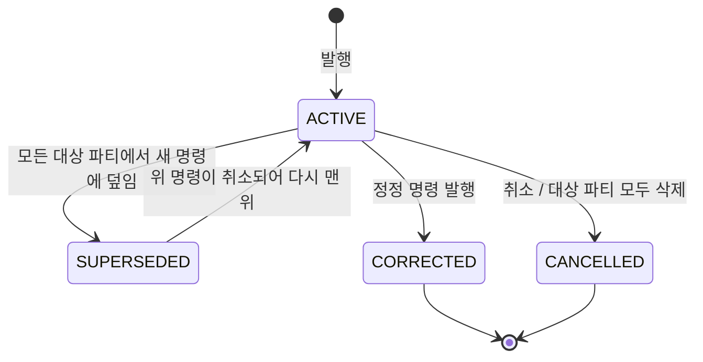
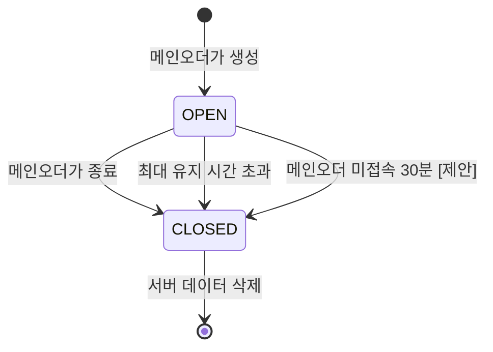

# 도메인 모델과 실시간 프로토콜

모든 기능이 함께 쓰는 개념, 상태 규칙, 메시지 규격을 정의한다. 기능 명세(features/)는 이 문서의 용어를 그대로 쓴다.

## 1. 용어

| 용어 | 뜻 |
|---|---|
| 오더방 (Room) | 동맹전 한 판을 위한 임시 공간. 방 코드로 식별한다 |
| 메인오더 (Commander) | 방을 만든 사람. 명령 발행·정정·취소, 파티 구성 변경, 방 설정·종료 권한이 있다. 방에 한 명 |
| 서브오더 (Sub-commander) | 메인오더가 링크(`subCommanderToken`)로 권한을 나눠 준 사람. 전체 파티에 명령을 발행·정정·취소할 수 있다. 파티 구성·방 설정·방 종료는 못 한다. 메인·서브 명령이 겹치면 슬롯 규칙(§3.1)대로 최신 명령이 우선한다 |
| 보조 운영자 (Operator) | 링크(`operatorToken`)로 들어와 인식 원문·후보를 보고 오발행을 취소하거나 수동 명령을 내는 사람. 명령 권한은 서브오더와 같고 방 관리 권한은 없다 |
| 발행자 (Issuer) | 명령을 낸 연결의 역할. 서버가 연결 정보로 채운다. 역할만 담는다 (§2) |
| 동맹원 (Member) | 방에 참여해 명령을 보는 사람 |
| 파티 (Party) | 명령 대상 단위. 방마다 개수와 이름이 다르고 운영 중에 바뀔 수 있다 |
| 명령 (Command) | 대상 + 행동 + 위치로 구성된 전술 지시 한 건 |
| 슬롯 (Slot) | 파티별 "현재 유효한 명령" 자리. 파티마다 하나 |
| 후보 (Candidate) | 추출은 됐지만 확신이 낮아 자동 발행하지 않은 명령. 메인오더 화면에만 보인다 |
| 이벤트 (Event) | 서버가 방 상태를 바꿀 때 내보내는 순번(seq) 있는 메시지 |

## 2. 엔티티

```ts
type PartyId = string;    // 생성 시 부여하는 안정적 ID. 번호·이름이 바뀌어도 유지된다
type CommandId = string;

interface Room {
  code: string;                 // 6자리. 혼동 문자(0,O,1,I,L) 제외
  status: 'OPEN' | 'CLOSED';
  createdAt: number;
  expiresAt: number;            // 최대 유지 시간 [제안: 4시간]
  commanderTokenHash: string;   // 메인오더 권한 확인용. 원문 토큰은 메인오더 브라우저에만 있다
  operatorTokenHash: string;    // 보조 운영자 링크 확인용
  subCommanderTokenHash?: string; // 서브오더 링크 확인용. 서브오더 도입 전에 만든 방에는 없다(그 방에서는 서브오더 접속 불가)
  settings: RoomSettings;
  parties: Party[];
  partyConfigVersion: number;   // 파티 구성이 바뀔 때마다 1 증가
  slots: Record<PartyId, CommandId[]>; // 파티별 명령 스택. 마지막 원소가 현재 명령
  commands: Command[];          // 최근 N건 [제안: 50건]
  seq: number;                  // 마지막 이벤트 순번
}

interface RoomSettings {
  maxMembers: number;           // [제안: 60]
  shareTranscript: boolean;     // 인식 원문을 동맹원에게 공유할지. 기본값 false
}

interface Party {
  id: PartyId;
  number: number;               // 화면에 보이는 번호(1부터). 순서를 바꾸면 다시 매긴다
  name?: string;                // 예: "돌격", "수비"
  aliases: string[];            // 음성 인식용 별칭. 예: ["돌격대", "돌격조"]
  color: string;                // HUD 색상 토큰
}

type Action = 'GATHER' | 'MOVE' | 'ATTACK' | 'DEFEND' | 'RETREAT' | 'SUPPORT' | 'HOLD';

type Target =
  | { kind: 'ALL' }
  | { kind: 'PARTIES'; partyIds: PartyId[] };

interface Location {
  id: string;                   // 예: "CENTER", "LEFT", "guild:A-gate"
  label: string;                // 화면 표시용. 동맹원은 사전 없이 이 값만 쓴다
}

interface Command {
  id: CommandId;
  seq: number;                  // 발행 시점의 이벤트 순번
  target: Target;
  action: Action;
  location?: Location;
  supportPartyIds?: PartyId[];  // SUPPORT의 지원 대상 파티
  status: 'ACTIVE' | 'SUPERSEDED' | 'CORRECTED' | 'CANCELLED';
  source: 'VOICE' | 'MANUAL';
  transcript?: string;          // 인식 원문. shareTranscript가 false면 동맹원에게 보내지 않는다
  confidence?: number;          // 0~1. VOICE일 때만
  issuedAt: number;
  repeatedAt?: number;          // 같은 명령이 다시 말해진 마지막 시각
  correctsId?: CommandId;       // 정정 명령이면 원래 명령 ID
  cancelReason?: 'MISRECOGNIZED' | 'CHANGED' | 'PARTY_REMOVED';
  issuer?: Issuer;              // 없으면 발행자를 모르는 명령(이 필드가 생기기 전의 방)
}

// clientId와 닉네임은 넣지 않는다: 스냅샷 크기(명령 50건 x 발행자)와 clientId 노출을 피한다
interface Issuer {
  role: 'COMMANDER' | 'SUB_COMMANDER' | 'OPERATOR';
}
```

동맹원(Member)은 서버 연결 단위로만 존재하고 저장하지 않는다.

```ts
interface Member {
  connectionId: string;
  clientId: string;             // 브라우저에 저장한 임의 ID. 재접속 시 같은 사람으로 본다
  role: 'COMMANDER' | 'SUB_COMMANDER' | 'OPERATOR' | 'MEMBER';
  partyId: PartyId | null;
  nickname?: string;            // 선택 입력
}
```

## 3. 명령 상태 규칙

### 3.1 슬롯 규칙

- 파티마다 명령 스택이 하나 있고, 스택의 맨 위가 그 파티의 현재 명령이다.
- `ALL` 명령은 발행 시점의 모든 파티 스택에 올라간다. 그 뒤에 추가된 파티의 스택은 비어 있다.
- 어떤 명령이 어느 스택의 맨 위에도 없으면 상태가 `SUPERSEDED`가 된다.

예시 (각 칸은 그 시점의 현재 명령):

| 사건 | 1파티 | 2파티 | 3파티 |
|---|---|---|---|
| ① 전체 / 집결 / 중앙 | ① | ① | ① |
| ② 3파티 / 방어 / 우측 | ① | ① | **②** |
| ③ 1·2파티 / 공격 | **③** | **③** | ② |
| ③ 취소 (오인식) | ① 복귀 | ① 복귀 | ② |

### 3.2 상태 전이



### 3.3 이벤트별 처리

| 이벤트 | 처리 |
|---|---|
| 발행 | 대상 파티 스택마다 새 명령을 올린다 |
| 반복 | 최근 10초 [제안] 안에 대상·행동·위치가 같은 명령이 있으면 새로 만들지 않는다. `repeatedAt`만 갱신해 "재강조"로 보여 준다 |
| 정정 | 원래 명령을 각 스택에서 새 명령으로 바꾸고, 원래 명령은 `CORRECTED`가 된다. 원래 명령이 있던 자리를 그대로 이어받는다 |
| 취소 | 명령을 모든 스택에서 뺀다. 그 아래 명령이 다시 현재 명령이 된다. 단, 아래 명령이 15분 [제안] 이상 지났으면 비운다 |
| 파티 삭제 | 삭제된 파티의 스택을 지운다. 대상 파티가 모두 사라진 명령은 `CANCELLED`(`PARTY_REMOVED`)가 된다 |
| 파티 추가 | 빈 스택을 만든다. 기존 `ALL` 명령은 새 파티에 적용하지 않는다 |

명령은 시간이 지나도 자동으로 만료되지 않는다. 대신 HUD가 경과 시간을 보여 주고, 오래된 명령은 흐리게 표시한다 ([F05](features/F05-tactical-hud.md)).

## 4. 권한

| 동작 | 메인오더 | 서브오더 | 운영자 | 동맹원 |
|---|---|---|---|---|
| 명령 발행·정정·취소 | O | O | O | X |
| 파티 구성 변경 | O | X | X | X |
| 방 설정 변경, 방 종료 | O | X | X | X |
| 음성인식 상태 보고(`stt.status`) | O | X | X | X |
| 인식 원문·후보(`stt.feed`) 보기 | O | O | O | X |
| 내 파티 선택 | O | O | O | O |
| 명령·이력·접속 현황 보기 | O | O | O | O |

역할은 방을 만들 때 발급한 토큰(`commanderToken`, `operatorToken`, `subCommanderToken`)으로 확인한다. 메인오더 토큰은 메인오더 브라우저의 로컬 저장소에만 둔다. 서버는 해시만 보관한다. 서브오더·운영자 토큰은 메인오더가 링크(`/s/:code#token`, `/o/:code#token`)로 나눠 준다.

- 같은 링크를 여러 명이 써도 막지 않는다. 서버는 어떤 사람이 썼는지 구분하지 못하고, 이미 나눠 준 링크를 회수하는 수단도 없다 (한계). 방은 최대 4시간 뒤 닫힌다.
- 서브오더·운영자의 접속은 방 수명(메인오더 미접속 30분)과 HUD의 "메인오더 연결 끊김" 표시에 영향을 주지 않는다.

## 5. 방 생명주기



- 방이 닫히면 서버는 모든 연결에 `room.closed`를 보내고 저장한 상태를 지운다.
- 방을 닫기 직전, 메인오더 브라우저는 세션 요약을 로컬에 저장한다 ([F07](features/F07-command-state.md)).

## 6. WebSocket 메시지 규격

- 모든 메시지는 JSON이고 `v: 1` 필드를 갖는다. 양쪽 모두 Zod로 검증한다.
- 검증에 실패한 메시지는 버리고 `error`로 응답한다.

### 6.1 클라이언트 → 서버

| type | 보내는 사람 | 필드 | 설명 |
|---|---|---|---|
| `hello` | 모두 | `roomCode`, `clientId`, `role`, `commanderToken?`, `lastSeq?`, `nickname?` | 연결 직후 처음 보내는 메시지. `lastSeq`가 있으면 재접속으로 본다 |
| `party.select` | 모두 | `partyId \| null` | 내 파티 선택 |
| `ping` | 모두 | `t` | 연결 확인 (15초 간격 [제안]) |
| `command.issue` | 메인오더 | `clientCmdId`, `target`, `action`, `location?`, `supportPartyIds?`, `source`, `transcript?`, `confidence?` | 명령 발행 |
| `command.correct` | 메인오더 | `clientCmdId`, `correctsId`, 바뀐 필드 | 정정 |
| `command.cancel` | 메인오더 | `commandId`, `reason` | 취소 |
| `parties.update` | 메인오더 | `baseVersion`, `parties` | 파티 구성 전체를 교체 |
| `room.settings` | 메인오더 | `settings` 일부 | 방 설정 변경 |
| `room.close` | 메인오더 | — | 방 종료 |

`clientCmdId`는 메인오더 브라우저가 만든 고유 ID다. 재접속 뒤 같은 메시지를 다시 보내도 서버가 한 번만 처리한다.

### 6.2 서버 → 클라이언트

| type | 필드 | 설명 |
|---|---|---|
| `welcome` | `role`, `memberId`, `snapshot` | `hello`에 대한 응답 |
| `snapshot` | `seq`, `settings`, `parties`, `partyConfigVersion`, `slots`, `commands`, `presence` | 방 전체 상태. 처음 접속할 때와 순번이 빠졌을 때 보낸다 |
| `event` | `seq`, `kind`, `payload` | 상태 변경. `kind`: `command.issued`, `command.repeated`, `command.corrected`, `command.cancelled`, `parties.updated`, `settings.updated` |
| `ack` | `clientCmdId`, `commandId?`, `error?` | 메인오더 요청에 대한 결과 |
| `presence` | `total`, `byParty` | 접속 현황. 순번 없음, 최대 2초에 한 번 [제안] |
| `pong` | `t` | 지연 측정용 |
| `error` | `code`, `message` | 오류 |
| `room.closed` | `reason` | 방 종료 |

### 6.3 순번 규칙

- 서버는 상태를 바꾸는 `event`마다 `seq`를 1씩 올린다.
- 클라이언트는 마지막으로 받은 `seq`를 기억한다. 받은 `seq`가 `마지막 + 1`이 아니면 `snapshot`을 다시 요청한다.
- 재접속할 때 `lastSeq`를 보낸다. 서버는 그 뒤 이벤트를 보내는 대신 항상 `snapshot`을 보낸다. 방 상태가 작아서 이 방식이 가장 단순하다.

### 6.4 오류 코드

| code | 상황 |
|---|---|
| `ROOM_NOT_FOUND` | 방 코드가 없거나 닫혔다 |
| `ROOM_FULL` | 접속 인원 상한 |
| `FORBIDDEN` | 동맹원이 메인오더 전용 메시지를 보냈다 |
| `RATE_LIMITED` | 요청 빈도 초과 |
| `VERSION_CONFLICT` | `parties.update`의 `baseVersion`이 오래됐다 |
| `INVALID_MESSAGE` | 형식 검증 실패 |
| `UNKNOWN_PARTY` | 없는 파티를 대상으로 지정했다 |

## 7. 제한 값 [제안]

| 항목 | 값 | 근거 |
|---|---|---|
| 방당 최대 접속 | 60 | 30명 목표의 2배 여유. Q3 답에 따라 조정 |
| 메인오더 요청 빈도 | 초당 5건 | 사람이 말하는 속도보다 충분히 높다 |
| 동맹원 요청 빈도 | 초당 2건 | `party.select`와 `ping`만 보낸다 |
| 방 최대 유지 | 4시간 | 동맹전 한 판과 준비 시간 |
| 메인오더 미접속 종료 | 30분 | 메인오더 브라우저가 죽어도 방이 남지 않게 한다 |
| 보관 명령 수 | 50건 | 이력 화면과 스냅샷 크기 |
| 파티 수 | 1~12 | HUD에 한 번에 보일 수 있는 수 |
| 파티 이름 | 10자 | HUD 표시 폭 |
