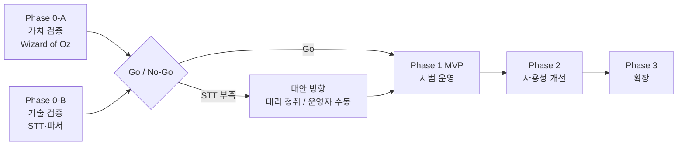

# 로드맵과 PoC 계획

작성일: 2026-11-26 · 기간은 1인 개발 기준 상대 기간이다.

## 1. 전체 흐름



Phase 0은 두 갈래로 동시에 진행한다. 가치 검증은 STT 없이 할 수 있으므로 기술 검증을 기다리지 않는다.

## 2. Phase 0 — 검증 (2~3주)

### 0-A 가치 검증: Wizard of Oz 시범

STT 대신 **기획자가 디스코드를 들으면서 손으로 명령을 발행**한다. 동맹원 입장에서는 실제 서비스와 같은 화면을 본다.

| 항목 | 내용 |
|---|---|
| 필요한 것 | F01(최소), F04, F05·F06(최소), F08 버튼 패널. 실제 MVP 코드의 첫 조각으로 만든다 |
| 진행 | 실전 동맹전 1~2회. 기획자가 방을 만들고 명령을 입력한다 |
| 관찰 | 접속률, 파티 선택 비율, 동맹원이 화면을 본 시점, 일부러 섞은 오발행 1건을 누가 언제 알아차리는지 |
| 사후 설문 | "명령 파악에 도움이 됐나", "어디서 봤나(휴대폰/보조 모니터/알트탭)", "알림음이 방해됐나" |
| 검증 가정 | A-2, A-3, A-4, A-12, A-13, A-14, A-21 |

시작 전에 메인오더 인터뷰(A-1)와 동맹원 설문(A-2, A-3)을 먼저 한다.

### 0-B 기술 검증

| ID | 검증 항목 | 방법 | 통과 기준 |
|---|---|---|---|
| P-1 | 연속 실행·백그라운드·마이크 공유 | 게임 실행 + 디스코드 통화 중 브라우저 STT를 30분, 3회 실행. Chrome·Edge | 3회 모두 끊김 없음. 디스코드 통화 정상 |
| P-2 | STT 정확도 | 실전 메인오더 발화 200건 이상을 녹음(동의, 라벨링 후 삭제)해 같은 오디오를 후보 모델 전부에 넣고 비교한다 ([모델 조사](research/korean-stt-models.md)) | 명령 발화의 핵심 단어(파티, 행동, 위치) 인식률 90% 이상 |
| P-3 | 파서 정확도 | 발화별 기대 결과(JSON)를 붙인 골든 테스트. 사람 받아쓰기 입력과 STT 출력 입력을 따로 잰다 | 재현율 95%, 자동 발행 정밀도 99%, 오발행 1% 미만 (F03 품질 목표) |
| P-4 | 게임 성능 영향 | 같은 장면에서 STT 켬/끔 FPS를 5분씩 3회 비교. CPU·메모리 기록 | FPS 감소 5% 이하 |
| P-5 | 지연 | 발화 종료 시각 → 동맹원 화면 표시 시각을 로그로 측정 | 중앙값 1초 이하, p95 1.5초 이하 |
| P-6 | 리소스 안정성 | 30분 실행 중 1분마다 메모리, 처리 지연 기록 | 메모리 증가 50MB 이하, 처리 지연 증가 없음 |
| P-7 | 동시 접속 | 가짜 클라이언트 60개로 부하 테스트 | 중계 지연 p95 200ms 이하 |
| P-8 | 대리 청취 (조건부) | A-1이 "아니오"일 때만. 디스코드 출력 캡처로 P-2·P-3 반복 | P-3 기준의 정밀도 유지 |

### 데이터셋 만들기

| 단계 | 내용 |
|---|---|
| 수집 | 메인오더 동의 후 실전 1~2회 녹음. 메인오더 마이크 쪽에서 녹음해야 디스코드 압축이 없다 |
| 자르기 | 발화 단위로 자른다 (STT의 끝점 검출 결과 활용) |
| 라벨 | 발화마다 받아쓰기 + 기대 결과(ISSUE/CORRECT/CANCEL/NONE과 슬롯)를 붙인다 |
| 보관 | 기획자 로컬에만. 저장소에는 받아쓰기와 라벨(텍스트)만 커밋하고 오디오는 커밋하지 않는다 |
| 삭제 | Phase 1 시작 시 오디오 삭제. 메인오더에게 삭제를 알린다 |

### Go / No-Go

| 결과 | 결정 |
|---|---|
| 0-A 설문 "도움됨" 60% 이상 + 메인오더 동의 + P-1~P-6 통과 | **Go**. 원래 설계대로 Phase 1 |
| 0-A 긍정 + STT 기준 미달 | **방향 전환**. ① 대리 청취 모드 ② 운영자 수동 모드를 기본으로 하고 STT는 보조 ③ (최후) 사용자 동의를 받은 Web Speech API. 중 하나를 고른다 |
| 0-A 부정 (동맹원이 화면을 안 봄) | **멈춤**. 문제 정의를 다시 한다. 알림음 중심, 파티장 전달 보조 등 다른 해법을 검토한다 |
| 메인오더 거절 | 대리 청취 모드(P-8) 또는 운영자 수동 모드로 Phase 1 |

## 3. Phase 1 — MVP (4~6주)

### 저장소 구조 [제안]

```
apps/
  web/            React + Vite. 메인오더 화면, 동맹원 화면
  server/         Cloudflare Worker + Durable Object (방)
packages/
  protocol/       Zod 메시지 스키마, 공통 타입 (서버·웹 공용)
  room-core/      슬롯 규칙 등 방 상태 순수 함수 (서버 사용, 테스트 대상)
  parser/         명령 추출 순수 함수 + 기본 사전 + 골든 테스트
  stt/            AudioWorklet, Web Worker, sherpa-onnx 연동
```

`room-core`와 `parser`를 따로 두는 이유: 두 모듈이 서비스 품질을 결정하고, 네트워크나 화면 없이 테스트할 수 있어야 하기 때문이다.

### 스프린트 [제안]

| 스프린트 | 범위 | 완료 조건 |
|---|---|---|
| S1 (1주) | 저장소 구성, `protocol`, Durable Object 방, F01 기본, F04, F10 기본 | 두 브라우저가 같은 방에서 수동 이벤트를 주고받고, 끊었다 이어도 복원된다 |
| S2 (1~2주) | `room-core` 슬롯 규칙 + 테스트, F05·F06 HUD, F07 | 도메인 §3의 모든 규칙이 테스트로 통과하고, 휴대폰에서 HUD가 보인다 |
| S3 (1~2주) | F02 통합, `parser` + F03, F08 메인오더 화면 | 말한 명령이 동맹원 화면에 1초 안에 뜨고, 후보·취소·정정이 동작한다 |
| S4 (1주) | 세션 요약, 안정화, 부하 테스트, 동맹원 안내 | 실전 시범 2회를 사고 없이 마친다 |

Phase 0-A에서 만든 코드가 S1·S2의 일부가 된다.

### MVP 종료 조건

- 실전 동맹전 2회 연속, 메인오더가 끝까지 켜 둔다.
- 세션 요약으로 KR1~KR3을 잴 수 있다.
- 출시 차단 Tigers(T1~T4) 대응이 끝났다.

## 4. Phase 2 — 사용성 개선 (실전 피드백 후)

우선순위는 시범 운영 결과로 다시 정한다. 현재 예상 순서:

| 순위 | 항목 | 관련 |
|---|---|---|
| 1 | 동맹 사전 편집기, 사전 테스트, 내보내기·가져오기 | F09 |
| 2 | 작은 창 모드 (Document Picture-in-Picture) | F05, T5 |
| 3 | 휴대폰 리모컨 (메인오더 권한을 두 번째 기기에) | F08 |
| 4 | 전술 프리셋 | F08 |
| 5 | 복합 명령과 문맥 처리 ("아까 거기로") | F03, E2 |
| 6 | 모바일 UI 최적화, 파티 8개 이상 격자 | F05, F06 |
| 7 | 호출어 모드 (선택) | F02 |
| 8 | 명령 이력 로컬 저장 | F07 |

## 5. Phase 3 — 확장 (정착 후)

- 동맹전 지도 위 전술 시각화
- 전술 보드 연동
- 복수 지휘관
- 파티별 명령 확인 응답
- 명령 타임라인과 리플레이
- WindsKit의 다른 동맹 운영 도구와 연계
- 다른 동맹으로 확산 (A-22 검증 후)
