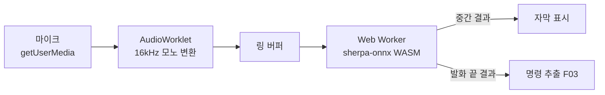

# F02 연속 음성인식

| 항목 | 내용 |
|---|---|
| 단계 | Phase 0 검증 → Phase 1 (MVP) |
| 우선순위 | Must. 서비스의 전제 |
| 관련 문서 | [기술 결정](../06-tech-decisions.md), [PoC 계획](../05-roadmap-and-poc.md) |

## 왜 필요한가

- 메인오더가 추가 조작 없이 평소처럼 말해야 한다. 그러려면 음성을 계속 듣고 있어야 한다.
- 음성을 서버로 보내면 비용이 들고 개인정보 부담이 생긴다. 그래서 메인오더 브라우저 안에서 인식한다.

## 아이디어

| 안 | 내용 | 판단 |
|---|---|---|
| 브라우저 로컬 STT (sherpa-onnx WASM) | 무료, 음성이 밖으로 나가지 않음 | **채택 후보**. PoC로 정확도와 부하를 확인한다 |
| Web Speech API | 구현이 쉽다. Chrome은 음성을 구글 서버로 보낸다 | 보조안. Local-first 원칙과 어긋나므로, PoC에서 로컬 STT가 실패할 때만 사용자 동의를 받아 검토한다 |
| 클라우드 STT API | 정확도 높음 | 제외 (MVP 제외 범위, 비용 발생) |
| 호출어 모드 ("오더, ...") | 호출어 뒤 발화만 명령으로 본다. 오발행이 줄어든다 | Phase 2 선택 기능. 메인오더의 말투를 바꾸므로 기본값은 끈다 |
| 핫워드 강화 | 파티 이름, 거점 이름 같은 단어를 우선 인식 | PoC에서 sherpa-onnx의 핫워드 기능이 한국어 모델에서 동작하는지 확인한다 |
| 대리 청취 모드 | 메인오더 마이크 대신 다른 사람 PC에서 디스코드 출력 소리를 캡처해 인식 | 조건부. 메인오더가 마이크 사용을 거절할 때(A-1) PoC P-8로 측정한다. 여러 목소리가 섞이고 압축 음질이라 정확도가 떨어질 수 있다 ([프리모템 E1](../04-pre-mortem.md)) |

## 처리 구조

- 오디오 처리와 인식은 메인 스레드 밖에서 한다. 화면이 멈추지 않게 하고, 백그라운드 탭에서도 계속 돌게 하기 위해서다.
- 인식기는 발화가 끝날 때마다(endpoint) 스트림 상태를 초기화한다. 장시간 실행에서 메모리가 쌓이지 않게 한다.
- 모델 파일은 처음 한 번 내려받아 브라우저 저장소(Cache Storage 또는 OPFS)에 둔다. 다음부터는 바로 시작한다.

## 전략

- **놓치는 것보다 잘못 보내는 것이 더 나쁘다.** STT는 들리는 대로 내보내고, 명령 여부 판단은 F03이 엄격하게 한다.
- **듣고 있다는 사실을 항상 보여 준다.** 메인오더 화면과 동맹원 화면 모두에 마이크 상태를 표시한다.
- **멈추면 스스로 살아난다.** 오디오 프레임이 3초 동안 들어오지 않으면 경고를 띄우고 인식기를 다시 시작한다.

## 기능 요구사항

| ID | 요구사항 |
|---|---|
| FR-F02-1 | 메인오더는 "음성인식 시작" 버튼으로 마이크 권한을 요청하고 인식을 시작한다 |
| FR-F02-2 | 마이크 장치를 고를 수 있다. 마지막 선택을 기억한다 |
| FR-F02-3 | 음성 크기 막대와 상태(준비 중 / 듣는 중 / 멈춤 / 오류)를 보여 준다 |
| FR-F02-4 | 중간 인식 결과와 최종 결과를 자막으로 보여 준다. 최근 5줄을 남긴다 |
| FR-F02-5 | 30분 이상 끊김 없이 동작한다. 게임 창이 앞에 있어도 동작한다 |
| FR-F02-6 | 모델을 처음 내려받을 때 진행률을 보여 준다. 이후에는 저장된 모델을 쓴다 |
| FR-F02-7 | 오디오가 3초 이상 들어오지 않거나 인식기가 오류를 내면 자동으로 다시 시작하고 알린다 |
| FR-F02-8 | 음성 원본은 서버로 보내지 않고, 저장하지도 않는다 |
| FR-F02-9 | 메인오더는 언제든 인식을 멈추고 다시 시작할 수 있다 |
| FR-F02-10 | 동맹원 화면에 메인오더의 음성인식 상태(켜짐/꺼짐)를 보여 준다 |

## 비기능 요구사항

| ID | 요구사항 | 목표 [제안] |
|---|---|---|
| NFR-F02-1 | 발화 종료 감지 후 최종 결과까지 | 300ms 이하 |
| NFR-F02-2 | 발화 종료 감지에 필요한 무음 길이 | 0.5~0.8초. PoC에서 조정 |
| NFR-F02-3 | CPU 사용량 | 코어 1개의 50% 이하 |
| NFR-F02-4 | 30분 실행 후 메모리 증가 | 시작 대비 50MB 이하 |
| NFR-F02-5 | 게임 FPS 감소 | 5% 이하 |
| NFR-F02-6 | 모델 첫 다운로드 | 진행률 표시, 이후 시작 5초 이하 |

## 사용자 스토리

### US-F02-1 음성인식 시작
메인오더로서, 버튼 하나로 음성인식을 켜고 싶다. 그래야 동맹전 시작 전에 준비를 끝낼 수 있다.

1. 처음 누르면 브라우저 마이크 권한 창이 뜬다.
2. 권한을 거부하면 "마이크 권한이 필요합니다"와 브라우저 설정 방법을 보여 준다.
3. 모델이 없으면 내려받기 진행률을 보여 준다.
4. 준비가 끝나면 상태가 "듣는 중"으로 바뀌고 음성 크기 막대가 움직인다.
5. 디스코드가 같은 마이크를 쓰고 있어도 시작된다 (PoC 검증 항목).

### US-F02-2 인식 상태 확인
메인오더로서, 서비스가 내 말을 듣고 있는지 한눈에 알고 싶다. 그래야 안심하고 지휘에 집중할 수 있다.

1. 화면 상단에 큰 상태 표시가 있다. 색과 글자를 함께 쓴다.
2. 마지막으로 인식된 문장과 시각이 보인다.
3. 브라우저 탭 제목에 상태가 표시된다 (예: "● 듣는 중 - Winds Command").

### US-F02-3 자동 복구
메인오더로서, 인식이 멈추면 저절로 다시 살아나길 바란다. 그래야 게임 중에 브라우저를 확인하지 않아도 된다.

1. 오디오가 3초 이상 끊기면 인식기를 다시 시작한다.
2. 마이크 장치가 빠지면 "마이크 연결 끊김"을 보여 주고, 다시 꽂히면 이어서 동작한다.
3. 복구 횟수를 세션 요약에 남긴다.
4. 1분 안에 3번 실패하면 자동 복구를 멈추고 오류 상태로 둔다. 동맹원 화면에도 "음성인식 꺼짐"이 보인다.

### US-F02-4 개인정보 안내
메인오더로서, 내 목소리가 어디로도 보내지지 않는다는 것을 알고 싶다. 그래야 마이크를 켜 둘 수 있다.

1. 시작 전 안내에 "음성은 이 브라우저 안에서만 처리되고 저장하지 않습니다"가 있다.
2. 네트워크 탭에서 확인해도 오디오 데이터 전송이 없다.

## 예외 상황

| 상황 | 처리 |
|---|---|
| 브라우저가 백그라운드 탭을 멈춤 | 마이크를 쓰는 탭은 보통 멈추지 않는다. PoC에서 Chrome과 Edge를 확인한다. 멈추면 별도 창으로 띄우는 방법을 안내한다 |
| 게임 소리가 마이크로 들어감 | 브라우저의 잡음 제거와 에코 제거를 켠다. 헤드셋 사용을 권장한다 |
| 다른 사람 목소리(디스코드 출력)가 들어감 | 헤드셋이면 문제없다. 스피커를 쓰면 잘못 인식될 수 있으므로 안내한다 |
| 저사양 PC | 모델 크기가 다른 두 가지를 준비하고, 부하가 높으면 작은 모델을 권한다 (PoC에서 결정) |

## 열린 질문

- 한국어 스트리밍 Zipformer 모델의 크기와 정확도는? 실제 메인오더 발화로 측정해야 한다.
- 모바일 브라우저에서 메인오더 기능을 지원할까? MVP는 PC 브라우저(Chrome, Edge)만 지원한다 **[제안]**.
