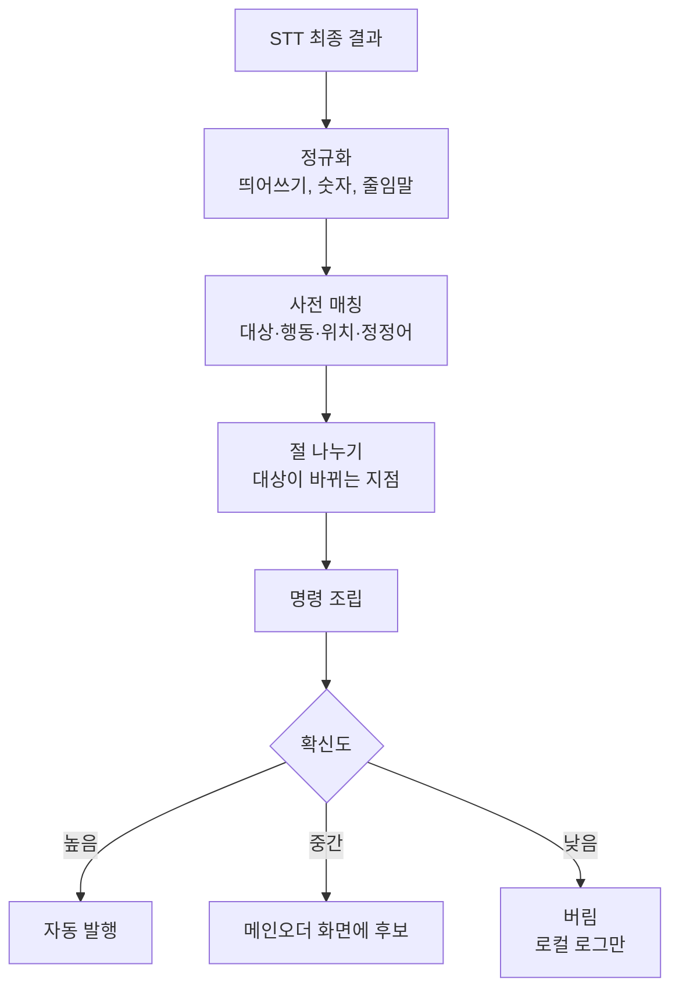

# F03 전술 명령 추출

| 항목 | 내용 |
|---|---|
| 단계 | Phase 0 검증 → Phase 1 (MVP) |
| 우선순위 | Must. 서비스 품질을 결정한다 |
| 관련 문서 | [도메인·프로토콜](../02-domain-and-protocol.md) §2~3, [F09 명령어 사전](F09-command-dictionary.md) |

## 왜 필요한가

- 메인오더 발화의 대부분은 명령이 아니다 ("상대 많네요", "좋아요"). 모두 보내면 화면이 소음이 된다.
- 잘못된 명령 한 건이 동맹원을 엉뚱한 곳으로 보낸다. 신뢰를 한 번 잃으면 화면을 보지 않게 된다.

## 아이디어

| 안 | 내용 | 판단 |
|---|---|---|
| 규칙 기반 파서 | 사전 + 패턴으로 대상·행동·위치를 찾는다 | **채택**. 로컬에서 즉시 동작하고, 왜 그렇게 판단했는지 설명할 수 있고, 테스트하기 쉽다 |
| 로컬 소형 언어모델 | 브라우저에서 작은 모델로 의도 분류 | 보류. 모델이 커지고 지연이 늘어난다. 규칙 기반 정확도가 부족할 때 Phase 2에서 다시 본다 |
| 클라우드 LLM | 문맥 이해가 좋다 | 제외 (비용, 지연, Local-first 원칙) |
| 확신도 3단계 | 높음은 자동 발행, 중간은 후보, 낮음은 버림 | **채택** |
| 음성 취소 | "방금 거 취소"라고 말하면 직전 음성 명령 취소 | **채택**. 메인오더가 손을 쓰지 않고 바로잡을 수 있다 |

## 처리 단계



### 1) 정규화

| 입력 예 | 정규화 결과 | 규칙 |
|---|---|---|
| 일 파티, 일팟, 1팟 | 1파티 | 숫자 말 + 파티/팟 |
| 이파티 | 2파티 | 숫자 말은 바로 뒤에 "파티/팟"이 올 때만 숫자로 본다. "이 파티"의 "이"(지시어)와 구분하기 위해서다 |
| 다들, 전원, 모두, 전체, 다 | 전체 | 대상 사전 |
| 가운데, 미드 | 중앙 | 위치 사전 |
| 왼쪽, 좌 | 좌측 | 위치 사전 |

### 2) 행동 사전 (기본값)

| 행동 | 표현 예 |
|---|---|
| GATHER 집결 | 모여, 모이세요, 뭉쳐, 집결 |
| MOVE 이동 | 가, 가세요, 이동, 넘어가, 이쪽으로 |
| ATTACK 공격 | 쳐, 때려, 들어가, 물어, 공격, 박아 |
| DEFEND 방어 | 지켜, 막아, 수비, 방어 |
| RETREAT 후퇴 | 빠져, 빼, 후퇴, 뒤로 빠져 |
| SUPPORT 지원 | 도와, 지원, 붙어줘 |
| HOLD 대기 | 대기, 멈춰, 기다려, 홀드 |

실제 표현은 PoC에서 메인오더 발화를 모아 보완한다. 동맹별 추가 표현은 F09에서 다룬다.

### 3) 절 나누기

"1파티 중앙, 3파티 오른쪽 지켜"처럼 대상이 여러 번 나오면 대상을 기준으로 절을 나눈다. 행동이 뒤에 한 번만 나오면 앞 절에 같은 행동을 적용한다. 단, 이렇게 채운 절은 확신도를 한 단계 낮춘다.

### 4) 정정과 취소

| 발화 | 처리 |
|---|---|
| "중앙 말고 오른쪽으로" | 15초 [제안] 안에 발행한 직전 명령의 위치를 우측으로 정정 (`command.correct`) |
| "아니 3파티 말고 4파티" | 직전 명령의 대상을 정정 |
| "방금 거 취소", "취소 취소" | 직전 음성 명령 취소 (`reason: MISRECOGNIZED`) |
| "말고"가 있는데 직전 명령이 15초보다 오래됨 | 정정으로 보지 않고 새 명령으로 판단 |

### 5) 확신도

| 등급 | 조건 | 처리 |
|---|---|---|
| 높음 | 행동이 사전에 정확히 맞고, 대상이 명시됐고(파티 번호·이름·전체), 서로 충돌하는 단어가 없다 | 자동 발행 |
| 중간 | 대상이 없다 / 행동이 약한 표현이다 / 절 나누기로 채운 값이 있다 | 메인오더 화면에 후보로 표시. 한 번 클릭으로 발행 |
| 낮음 | 행동이 없다 / 대상이 이 방에 없는 파티다 | 버린다. 튜닝용으로 메인오더 브라우저에만 기록 |

## 전략

- **파서는 순수 함수로 만든다.** `parse(text, context) → 결과[]`. 입력은 문장, 파티 구성, 사전, 직전 명령이다. 네트워크와 화면에 의존하지 않으므로 골든 테스트로 정확도를 잰다.
- **판단 근거를 남긴다.** 결과마다 어떤 단어가 어떤 슬롯에 매칭됐는지 기록한다. 메인오더 화면의 후보와 디버그 화면에서 보여 준다.
- **데이터로 정한다.** 대상 없는 명령(Q1) 같은 판단은 PoC 데이터셋에서 측정한 뒤 정한다.

```ts
interface ParseContext {
  parties: Party[];
  dictionary: Dictionary;   // F09
  lastVoiceCommand?: { command: Command; issuedAt: number };
  now: number;
}

type ParseResult =
  | { kind: 'ISSUE'; draft: CommandDraft; confidence: 'HIGH' | 'MEDIUM'; evidence: Match[] }
  | { kind: 'CORRECT'; correctsId: CommandId; patch: Partial<CommandDraft>; confidence: 'HIGH' | 'MEDIUM'; evidence: Match[] }
  | { kind: 'CANCEL'; commandId: CommandId; evidence: Match[] }
  | { kind: 'NONE'; reason: string };

function parse(text: string, ctx: ParseContext): ParseResult[];
```

## 기능 요구사항

| ID | 요구사항 |
|---|---|
| FR-F03-1 | STT 최종 결과마다 파서를 실행한다. 중간 결과로는 발행하지 않는다 |
| FR-F03-2 | 7개 기본 행동(GATHER, MOVE, ATTACK, DEFEND, RETREAT, SUPPORT, HOLD)을 인식한다 |
| FR-F03-3 | 대상으로 전체, 파티 번호, 파티 이름·별칭, 여러 파티를 인식한다 |
| FR-F03-4 | 기본 위치(중앙, 좌측, 우측, 앞, 뒤)와 사전에 등록한 거점을 인식한다 |
| FR-F03-5 | 한 문장의 여러 명령을 각각 만든다 |
| FR-F03-6 | 정정 표현으로 직전 명령을 정정한다 |
| FR-F03-7 | 음성 취소 표현으로 직전 음성 명령을 취소한다 |
| FR-F03-8 | 확신도 높음만 자동 발행한다. 중간은 메인오더 화면에 후보로 둔다 |
| FR-F03-9 | 방에 없는 파티를 대상으로 하면 발행하지 않는다 |
| FR-F03-10 | 판단 근거(매칭된 단어)를 결과에 포함한다 |
| FR-F03-11 | 파서 실행 시간은 문장당 5ms 이하다 |

## 품질 목표

| 지표 | 정의 | 목표 |
|---|---|---|
| 명령 재현율 | 실제 명령 중 자동 발행 또는 후보가 된 비율 | 95% 이상 |
| 자동 발행 정밀도 | 자동 발행된 명령 중 대상·행동·위치가 모두 맞은 비율 | 99% 이상 |
| 오발행률 | 명령이 아닌 발화가 명령으로 자동 발행된 비율 | 1% 미만 |

STT 오류를 포함한 전체 성능과 파서 단독 성능을 나누어 잰다. 측정 방법은 [PoC 계획](../05-roadmap-and-poc.md)에 있다.

## 사용자 스토리

### US-F03-1 말한 명령 자동 발행
메인오더로서, "3파티 오른쪽 지켜"라고 말하면 바로 발행되길 바란다. 그래야 손을 쓰지 않아도 된다.

1. 발화가 끝난 뒤 1초 안에 동맹원 화면에 "3파티 / 방어 / 우측"이 뜬다.
2. 메인오더 화면에 발행된 명령과 원문이 나란히 보인다.
3. 확신도 높음 조건을 모두 만족할 때만 자동 발행된다.

### US-F03-2 일반 발화 무시
메인오더로서, 명령이 아닌 말은 발행되지 않길 바란다. 그래야 동맹원이 혼란스럽지 않다.

1. "상대 인원이 생각보다 많네요"는 아무것도 발행하지 않는다.
2. 행동 단어가 없는 문장은 후보로도 만들지 않는다.
3. 버린 문장은 메인오더 브라우저의 튜닝 기록에만 남는다.

### US-F03-3 여러 파티 명령
메인오더로서, 한 문장으로 여러 파티에 다른 지시를 하고 싶다.

1. "1파티 2파티 중앙으로 모여"는 1·2파티 대상의 집결 명령 1건이 된다.
2. "1파티 중앙, 3파티 오른쪽 지켜"는 명령 2건이 된다.
3. 행동을 나눠 채운 절은 후보로 표시된다.

### US-F03-4 말로 정정·취소
메인오더로서, 잘못 말했거나 잘못 인식되면 말로 바로잡고 싶다.

1. "중앙 말고 오른쪽으로 이동"은 직전 명령을 우측으로 정정하고, 동맹원 화면에 "정정" 표시가 뜬다.
2. "방금 거 취소"는 직전 음성 명령을 취소하고, 이전 명령으로 되돌린다 (도메인 §3.3).
3. 직전 명령이 15초보다 오래됐으면 "말고"를 정정으로 보지 않는다.

### US-F03-5 후보 확인
메인오더로서, 애매한 명령은 후보로 보고 한 번에 발행하고 싶다.

1. 후보는 메인오더 화면에만 보이고 10초 [제안] 뒤 사라진다.
2. 후보 카드에는 해석 결과와 원문이 함께 보인다.
3. 클릭 한 번으로 발행하거나, 대상·위치를 고친 뒤 발행할 수 있다 (F08).

## 처리 예시 (골든 테스트 시작점)

| 발화 | 기대 결과 |
|---|---|
| 1파티 2파티 중앙으로 모여 | ISSUE 높음: 1·2파티 / GATHER / 중앙 |
| 3파티 오른쪽 지켜주세요 | ISSUE 높음: 3파티 / DEFEND / 우측 |
| 상대 인원이 생각보다 많네요 | NONE |
| 전원 뒤로 빠져 | ISSUE 높음: 전체 / RETREAT |
| 중앙 말고 오른쪽으로 이동 | CORRECT: 직전 명령 위치 → 우측, 행동 → MOVE |
| 중앙으로 모여 | ISSUE 중간 (대상 없음, Q1) |
| 2파티 1파티 지원 | ISSUE 높음: 2파티 / SUPPORT / 지원 대상 1파티 |
| 이 파티 너무 약하다 | NONE ("이"는 숫자로 보지 않음, 행동 없음) |
| 방금 거 취소 | CANCEL: 직전 음성 명령 |

## 열린 질문

- **Q1. 대상 없는 명령을 전체로 볼 것인가?** 메인오더가 대상을 자주 생략하면 재현율이 떨어진다. PoC 데이터에서 대상 생략 비율과 그 의도를 확인한 뒤 결정한다. "대상 없으면 전체"를 방 설정 옵션으로 둘 수도 있다.
- "들어가"는 공격인가 이동인가? 동맹마다 다를 수 있으므로 F09 사전으로 조정한다.
