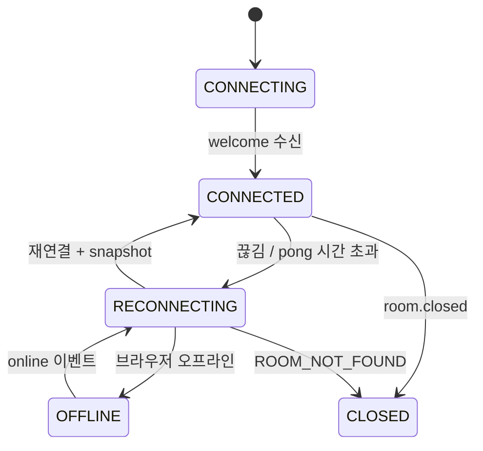

# F10 연결 상태 관리

| 항목 | 내용 |
|---|---|
| 단계 | Phase 1 (MVP) |
| 우선순위 | Must |
| 관련 문서 | [도메인·프로토콜](../02-domain-and-protocol.md) §6.3 순번 규칙, [F04 실시간 전달](F04-realtime-delivery.md) |

## 왜 필요한가

- 휴대폰은 화면이 꺼지거나 와이파이와 LTE를 오가며 자주 끊긴다.
- 끊긴 사실을 모르고 오래된 명령을 보고 있는 것이 가장 위험하다.
- 메인오더 연결이 끊기면 명령이 나가지 않는다. 동맹원도 그 사실을 알아야 한다.

## 전략

- **끊김을 숨기지 않는다.** 연결 상태를 항상 화면 위에 보여 준다.
- **돌아오면 전부 다시 받는다.** 재연결하면 스냅샷으로 현재 상태를 통째로 받는다. 놓친 이벤트를 골라 받는 방식보다 단순하고 틀릴 일이 없다.
- **메인오더는 끊겨도 듣는다.** 메인오더 브라우저의 음성인식은 연결과 무관하게 계속 돈다. 끊긴 동안 나온 명령은 짧은 시간만 대기열에 둔다.

## 연결 상태

| 상태 | 화면 표시 |
|---|---|
| CONNECTED | 초록 점 "연결됨" |
| RECONNECTING | 노란 띠 "다시 연결 중… 화면의 명령이 최신이 아닐 수 있습니다" + 명령 카드 흐리게 |
| OFFLINE | 빨간 띠 "인터넷 연결 없음" |
| CLOSED | "오더방이 종료되었습니다" |

## 재연결 규칙 [제안]

| 항목 | 값 |
|---|---|
| 하트비트 | 15초마다 `ping` |
| 끊김 판정 | 35초 동안 `pong` 없음, 또는 소켓 close |
| 재시도 간격 | 0.5초에서 시작해 2배씩, 최대 8초, ±20% 무작위 |
| 즉시 재시도 | 탭이 다시 보일 때(`visibilitychange`), 네트워크가 돌아올 때(`online`) |
| 재연결 메시지 | `hello`에 `lastSeq`와 `clientId`를 담는다 |
| 메인오더 대기열 | 끊긴 동안 발행한 명령을 보관. 재연결 후 보낸다. 10초보다 오래된 명령은 보내지 않고 메인오더에게 "전송되지 않은 명령"으로 보여 준다 |

## 기능 요구사항

| ID | 요구사항 |
|---|---|
| FR-F10-1 | 연결 상태를 모든 화면 상단에 항상 보여 준다 |
| FR-F10-2 | 끊기면 자동으로 재연결한다 (재연결 규칙) |
| FR-F10-3 | 재연결하면 스냅샷으로 파티 구성, 현재 명령, 이력을 복원한다 |
| FR-F10-4 | 재연결 중에는 명령 카드를 흐리게 하고 "최신이 아닐 수 있음"을 보여 준다 |
| FR-F10-5 | 동맹원의 파티 선택은 재연결 후에도 유지된다 |
| FR-F10-6 | 메인오더 연결이 끊기면 동맹원 화면에 "메인오더 연결 끊김"을 보여 준다 |
| FR-F10-7 | 메인오더가 끊긴 동안 발행한 명령은 대기열에 두고, 10초 안에 재연결되면 보낸다 |
| FR-F10-8 | 메인오더 브라우저를 새로고침해도 메인오더 권한과 방 상태가 복원된다 |
| FR-F10-9 | 방이 닫혔으면 재연결을 멈추고 종료 화면을 보여 준다 |

## 사용자 스토리

### US-F10-1 끊김 알아차리기
동맹원으로서, 연결이 끊겼으면 바로 알고 싶다. 그래야 오래된 명령을 믿지 않는다.

1. 끊긴 지 35초 안에 "다시 연결 중" 띠가 보인다.
2. 그동안 명령 카드는 흐리게 보인다.
3. 연결되면 띠가 사라지고 최신 명령이 보인다.

### US-F10-2 화면을 껐다 켜도 최신
동맹원으로서, 휴대폰 화면을 껐다 켜도 바로 최신 명령을 보고 싶다.

1. 화면이 다시 켜지면 즉시 재연결을 시도한다.
2. 재연결 뒤 1초 안에 현재 명령이 보인다.
3. 내 파티 선택이 그대로다.

### US-F10-3 메인오더 끊김 알림
동맹원으로서, 메인오더 쪽이 끊겼는지 알고 싶다. 그래야 화면 대신 음성에 집중한다.

1. 메인오더 연결이 끊기면 10초 안에 "메인오더 연결 끊김"이 보인다.
2. 메인오더 음성인식이 꺼져도 "음성인식 꺼짐"이 보인다 (F02).
3. 메인오더가 돌아오면 표시가 사라진다.

### US-F10-4 메인오더 새로고침
메인오더로서, 실수로 탭을 새로고침해도 이어서 지휘하고 싶다.

1. 새로고침 후 같은 방에 메인오더로 다시 들어간다.
2. 음성인식은 다시 켜야 한다. 브라우저 정책상 마이크는 사용자 동작이 있어야 켤 수 있으므로 "음성인식 다시 시작" 버튼을 크게 보여 준다.
3. 파티 구성과 현재 명령은 그대로다.

## 시험 방법

- 브라우저 개발자 도구에서 네트워크를 끊었다 연결한다.
- 휴대폰 비행기 모드를 켰다 끈다.
- 휴대폰 화면을 5분 동안 끈 뒤 켠다.
- 서버를 다시 배포하는 동안 모든 클라이언트가 복원되는지 본다.
